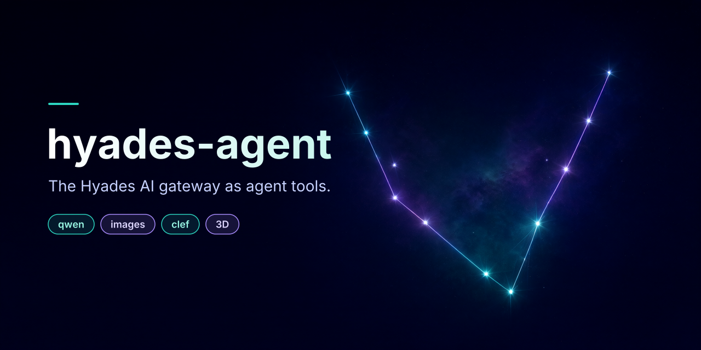

<div align="center">



# hyades-agent

**Claude Code integration for the [Hyades](https://hyades.gnostr.cloud) AI gateway**

qwen LLM · image generation & editing with quality checks · Clef System One decisions · 3D model generation

`MCP tools` · `skill` · `media subagent` — zero dependencies, one-command install

</div>

---

## Tools

Six typed tools exposed over MCP (stdio):

| Tool | What it does | Notes |
|:--|:--|:--|
| `hyades_models` | List model ids this key is actually authorized for | Authorization changes per key — always confirm |
| `hyades_chat` | qwen chat/completions: Q&A, code, tool calls, JSON | Auto-retries `429`; `json_mode: true` routes around Hyades' broken `response_format` |
| `hyades_image_generate` | `qwen-image-2.1` generation | `quality_check: true` runs Clef's quality gate; **saves the ephemeral result URL to a local file** before returning |
| `hyades_image_edit` | Scene/element edits on a local image | Same quality gate available |
| `hyades_clef` | Clef System One decision (`POST /v1/systemone`) | Local image paths in, data URLs out; returns score / choice / noul + probabilities |
| `hyades_3d_generate` | 3D model from prompt or source image | Handles sync (`200`) *and* async (`202` + polling, 10 min default window) |

Errors come back as **structured tool results** (`{error: <code>, message, retryable}`), not crashes — the agent can read and react. The API key is never echoed in output.

## Quick start

```bash
./install.sh        # copies skill + subagent into ~/.claude, registers the MCP server
```

Then in any Claude Code session:

```
> generate a product hero for a coffee app, quality-checked
> call clef and ask whether the attached screenshot shows an error state
> list the models my key can use
```

Requires a key at `~/.omp/agent/hyades.key` (`chmod 600`) or `HYADES_API_KEY` in the environment.

## Verified (2026-11-15, live against the gateway)

| Check | Result |
|:--|:--|
| `hyades_models` via MCP | `qwen3.8-27b`, `qwen3.8-27b-refusal-off` |
| Chat (`pong`) | exact `pong`, 1.5s |
| JSON mode workaround | clean `{"answer": 42}` |
| Image gen + quality gate | `passed`, score 0.93, file on disk |
| Image edit | saved, no gate → `null` quality |
| Clef decision | `noul: 0.994` in <1s |
| `403` contract | structured `forbidden` for unauthorized model |
| Skill discovery | headless `claude -p` read the skill and answered from it |
| End-to-end | headless session called `hyades_models` and returned the live list |

## Repo layout

```
hyades-agent/
├── mcp/
│   ├── hyades-server.mjs     # MCP stdio server (zero deps, Node ≥ 18)
│   └── smoke.mjs             # stdio smoke test (harness)
├── skills/hyades/
│   ├── SKILL.md              # trigger description + pitfalls
│   └── reference.md          # endpoint contracts, error table, quality fields
├── agents/hyades-media.md    # subagent: image/brand specialist
├── install.sh                # user-scope install
└── README.md
```

This folder is the source of truth; `~/.claude/...` copies are produced by `install.sh` — re-run it after any change. The key never leaves `~/.omp/agent/hyades.key`.

## Known pitfalls (baked into the server)

| Pitfall | Handled how |
|:--|:--|
| Cloudflare `1010` without a `User-Agent` | Server always sends one |
| 2 in-flight turns per silo → `429` | Automatic backoff retry (2.5s·n, ≤4); image jobs should stay serialized |
| `response_format` returns empty content | `json_mode` prompt-based workaround |
| Image result URLs are temporary | Downloaded to `saved_paths` before the tool returns |
| Quality gate self-retries (`attempts: 2`, ~60s) | Expected, not an error |
| `bun` here is the Windows build (can't see the WSL key path) | Registered under `node`; key lookup also covers `USERPROFILE` and `\\wsl.localhost` UNC paths |

## Error contract

| Status | Meaning | Action |
|:--|:--|:--|
| `401` | no / invalid bearer | fix the key |
| `403` | model not authorized for this key | use an authorized model |
| `403` · `1010` | Cloudflare block (missing User-Agent) | set User-Agent |
| `429` | concurrency limit (2 turns/silo) | back off, serialize |
| `400` | bad request (Clef URL image, wrong model) | fix the body |
| `503` | upstream backend down | transient — retry |

## Key rotation

If the key was ever pasted in chat: `POST /admin/keys/<key-name>/rotate` (via the gateway admin), then replace
`~/.omp/agent/hyades.key`. Nothing else to change.

## License

[MIT](LICENSE) © 2026 Traves Theberge. Covers this repo's code and docs. Using the Hyades gateway
requires your own API key and is governed by the gateway operator's terms.
